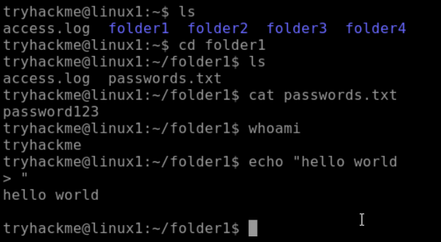
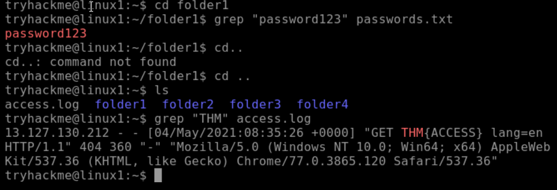
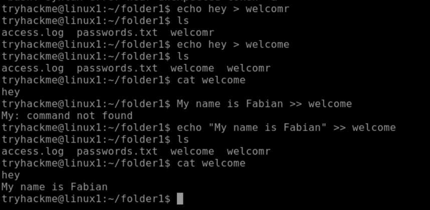

# Linux Fundamentals Part 1

**Platform:** TryHackMe  
**Room:** Linux Fundamentals Part 2  
**Difficulty:** Beginner  
**Date Completed:** 2026-10-16  
**Category:** Linux
---

## Overview

Learned about the Linux Operating System and how it is heavily utilized in the cybersecurity field. I learned basic Linux commands to navigate through folders and files, as well as search for specific files and text. The goal was to build familiarity with working in a terminal environment.

---

# Concepts Learned

## Linux Terminal Navigation

The Linux terminal provides a command-line interface (CLI) that allows users to interact with the operating system through text-based commands.

Rather than clicking through folders with a graphical interface, users can navigate and manage the system directly through commands.

### Cybersecurity Relevance

Many cybersecurity tools run entirely through the command line. Security analysts, penetration testers, incident responders, and system administrators frequently use Linux terminals to investigate systems and perform security tasks.

---

## Directory Navigation Commands

## Commands Learned

| Command | Purpose |
|----------|----------|
| whoami | Display current user |
| pwd | Display current directory |
| ls | List files and folders |
| cd | Change directories |
| cat | View file contents |
| find | Search for files |
| grep | Search for text |
| echo | Output text |

## Hands-On Activities
## Task 1
## Objective
Understand how to use basic commands on linux, focused mostly on navigating through different directories and files.
## Steps Taken
1. Understand where I am in the directories using basic linux commands. 
2. Move to different directories and create/ edit files using basic linux commands.
3. Understanding how to search through files or directories.
## Result
After understanding the principle linux commands taught I was able to find the THM flag in the access.log.
## Evidence
Screenshots:

# Reflection
I completed this room once before but forgot all the commands. After completing this room again and really taking my time to understand these basic Linux commands, I am now able to move through the Linux terminal like an experienced user.

