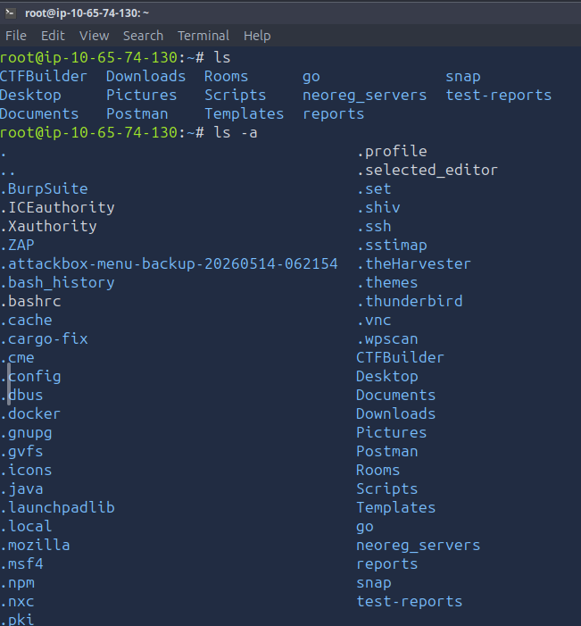
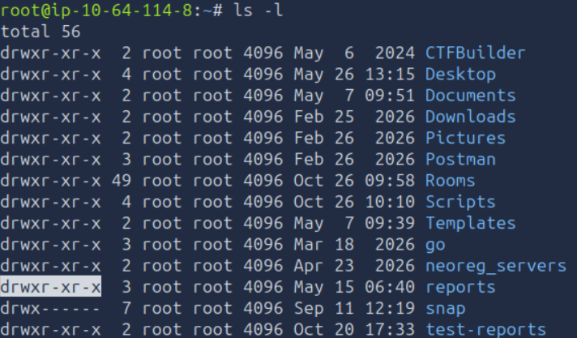

# Linux Fundamentals Part 2

**Platform:** TryHackMe  
**Room:** Linux Fundamentals Part 2  
**Difficulty:** Beginner  
**Date Completed:** 2026-10-20  
**Category:** Linux

---

# Overview

This room introduced fundamental Linux concepts including file management, directory management, user permissions, and common command-line utilities. The primary objective was to continue building familiarity with navigating and managing a Linux system through the command line.

---

# Key Concepts Learned

## File and Directory Management

I practiced creating, deleting, moving, and copying files and directories using Linux commands.

Commands learned included:

| Command | Purpose |
|----------|----------|
| touch | Create a file |
| mkdir | Create a directory |
| rm | Remove a file |
| rm -R | Remove a directory |
| cp | Copy files and folders |
| mv | Move or rename files |
| file | Identify file types |
| ls -l | View file permissions |

## Why It Matters

Security professionals frequently interact with files, logs, scripts, and reports. Knowing how to manage files efficiently from the terminal is an important skill when working with Linux.
---

## Linux Permissions

Linux permissions determine which users can read, write, or execute files and directories.

### Permission Values

| Permission | Value |
|------------|--------|
| Read (r) | 4 |
| Write (w) | 2 |
| Execute (x) | 1 |

Permissions are divided into three categories:

- Owner
- Group
- Others

### Why It Matters

Permissions are critical to cybersecurity because they control access to sensitive files and system resources.
Permissions are also vital to learn about because keeping important files or directories from being accessed by unauthorized users. 

---
# Hands-On Activities

### Tasks 1-2

### Objective

Understand how to use basic commands on linux, focused mostly on navigating through different directories and files. Learned the use of permissions for files. 

### Steps Taken

1. Understand where I am in the directories using basic linux commands. 
2. Move to different directories and create/ edit files using basic linux commands.
3. Understanding how to search through files or directories.
4. Understanding the 3 columns of the permissions list.
### Result

After understanding the principle linux commands taught I was able to find the THM flag in the access.log. Understood the importance of file or directory permissions and how they are related to accessibility by each user type.

### Evidence

#### File System Managment:

#### Permissions List: 

# Key Takeaways

- Learned how to create, delete, move, and copy files and directories.
- Learned how Linux permissions are structured.
- Learned how to interpret owner, group, and other permissions.
- Gained confidence using the Linux command line.
  
# Reflection

I was very intimidated at first with how to manage the files and directories through the Linux command line. 
I'm so used to working with the Windows GUI where creating, deleting copying files and folders with a few simple clicks.
But this room has helped me to have more confidence on file management and understanding more about what file permissions are and how to view who has what type of access to each file or directory.
I'm going to continue to practice these commands and learn how to change permissions for files so I can get more comfortable handling these things in the industry.
