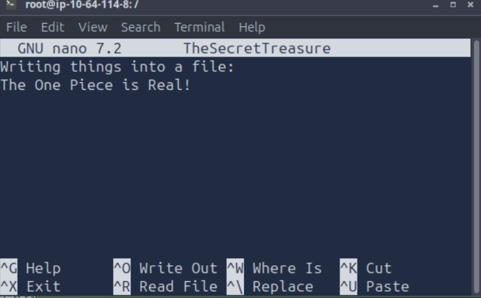
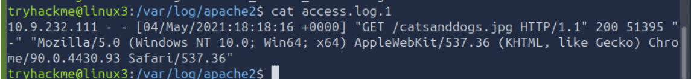

# Linux Fundamentals Part 3

**Platform:** TryHackMe  
**Room:** Linux Fundamentals Part 3  
**Difficulty:** Beginner  
**Date Completed:** 2026-10-31  
**Category:** Linux

---

# Overview

This room introduced fundamental Linux concepts including file editing, transfer/downloading files, running a web server.
Introduction to processes and how to read them, and finally log analysis.

---

# Key Concepts Learned

## Editing Files

### Explanation

Learned how to edit file contents directly from the Linux command line using Nano instead of recreating files.

### Why It Matters

This is important files often need to be updated, corrected, or modified without being recreated. Being able to quickly edit files in the terminal can save time and make system administration easier.

### Example

```bash
nano TheSecretTreasure
```

---

## File Transfers

### Explanation

Learned how to download and transfer files using Linux commands.

### Commands Learned

```bash
wget
```

Downloads files.

```bash
scp
```

Transfers files securely using SSH.

### Why It Matters

There are many files or tools that need to be downloaded and understanding how to transfer file securely is also an important skill.

---

## Processes and Services

### Explanation

Learned how to view running processes, monitor system activity, and manage services.

### Commands Learned

| Command | Purpose |
|----------|----------|
| ps | View processes |
| ps aux | View all processes |
| top | Monitor processes |
| systemctl | Manage services |

### Why It Matters

Understanding what processes are being used is important to see what the computer is working on in the background. This will help to identify if there is unusual activity going on.

---

## Log Analysis

### Explanation

Reviewed logs to identify which IP addresses visited a website and what files they accessed.

### Why It Matters

Being able to analyze logs is important to be able to figure out who accessed what files and at what time, this helps with investigations before or after an incident.

---

# Hands-On Activities

## Objectives

- Edit files with Nano
- Transfer files
- View running processes
- Review system logs

---

# Evidence

## Editing Files



## Download File



## Log Analysis


---

# Key Takeaways

- Learned how to edit existing files using Nano.
- Learned how to transfer files with wget and SCP.
- Learned how Linux handles processes and services.
- Performed my first basic log review.

---

# Reflection

This room felt like a major step forward from the previous Linux rooms.
As someone who wants to become a SOC analyst, this room was especially helpful because I learned where to access logs and how to analyze one. This will definitely be useful in the future. 
Although this is the end of the Linux introduction in Tryhackme I will continue to implement these commands from this room and previous rooms for future labs and the real environment.
